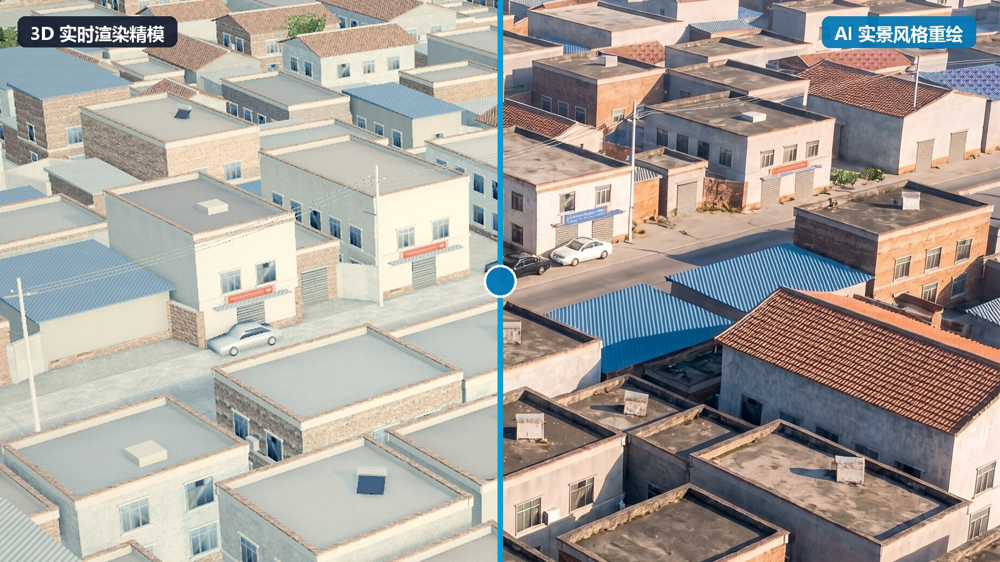
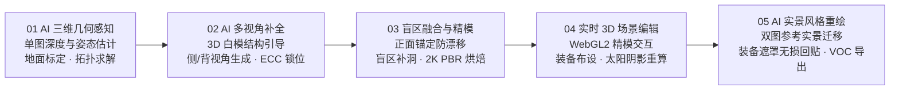
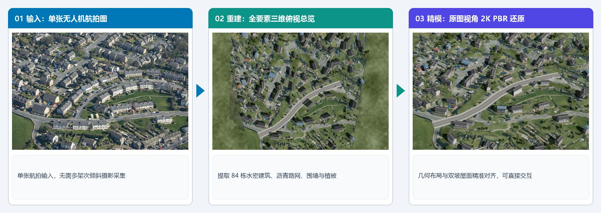
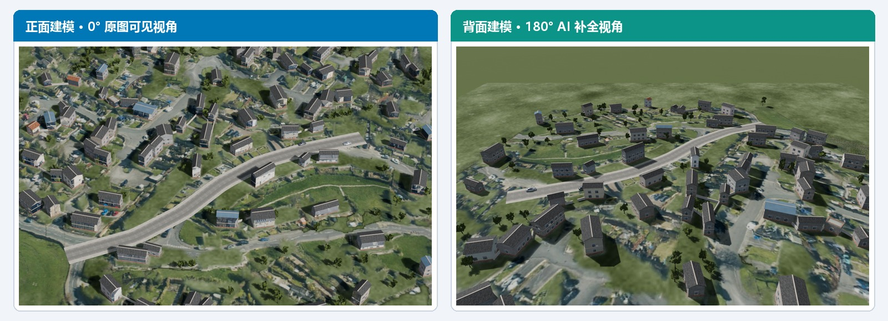
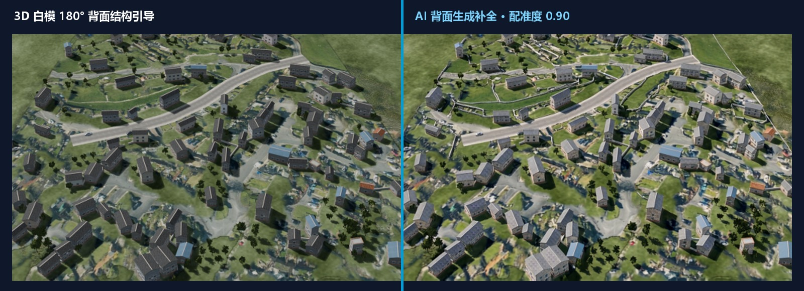
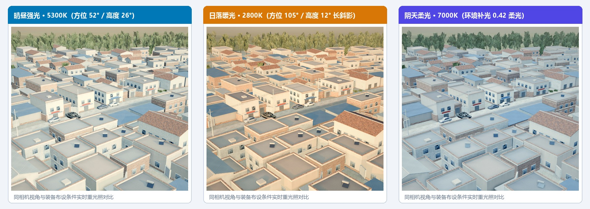
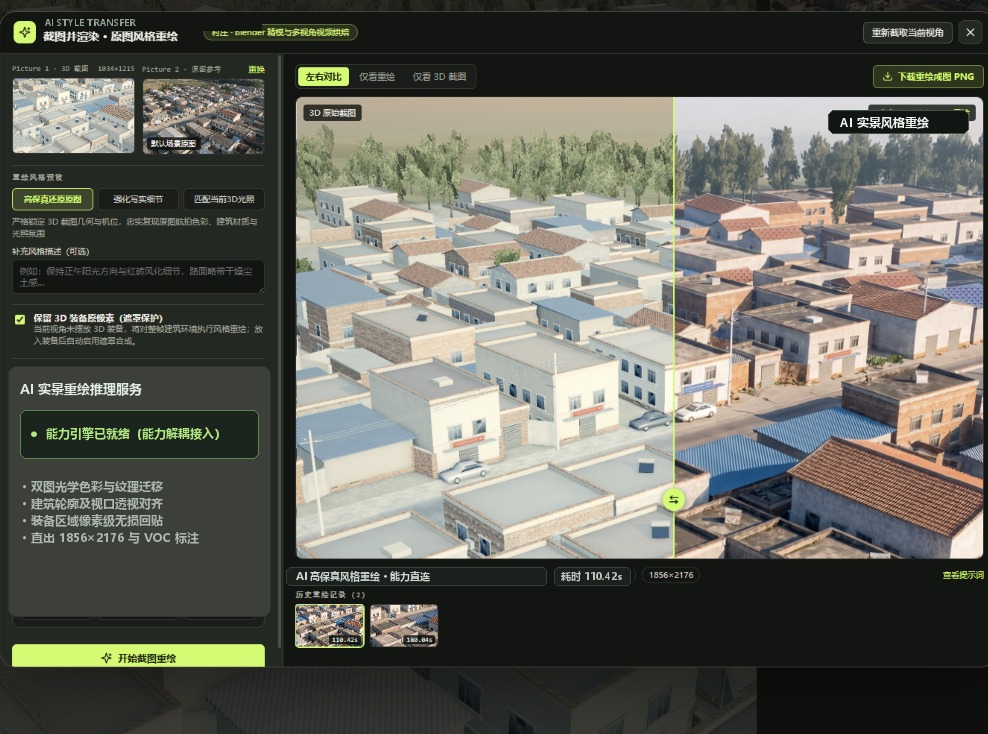

# AI 图生三维场景与高保真数据闭环 Demo (`scene-data-demo`)

> 以单张无人机/航拍图作为输入，串联 **AI 三维几何感知 → 多视角 AI 补全与几何配准 → 盲区融合与水密精模重构 → WebGL2 实时三维交互编辑与重光照 → 装备像素遮罩保护下的 AI 实景风格重绘**，实现从单图建景到高逼真合成训练样本导出的完整工程闭环。



---

## 核心能力与五阶段技术链路



- **单图公制重建**：支持从单张航拍原图恢复相机内参、地平面法向与建筑/路网/植被结构，自动求解闭合水密建筑网格与道路资产。
- **多视角补全与防漂移融合**：基于初版白模渲染 `-60° / +60° / 180°` 结构引导图生成侧/背视角，经相位相关与仿射 ECC 配准锁位后，仅针对未观测盲区补洞赋材并过滤阴影/植被离散误投，保障原图可见视角零退化。
- **实时 WebGL2 编辑与物理光影**：浏览器零插件加载 2K PBR 场景模型，支持装备拖拽布设、平移/旋转/缩放变换（非变换页签自动隐藏坐标轴）、预设机位巡检及太阳方位/高度/强度/色温与接触阴影实时联动。
- **AI 实景风格重绘与样本闭环**：基于「3D 视口截图 + 原图风格参考」双图引导进行实景光学质感迁移，对装备区域按像素遮罩无损回贴原始渲染像素，输出高清实景成图（如 `1856×2176`）与含 Pascal VOC 标注框的数据压缩包。

---

## 效果展示（实测效果图）

### 1. 从单张航拍图到全要素三维精模构建

仅输入单张航拍照片，无需多架次倾斜摄影采集，自动拆分建筑、道路、院墙与植被要素并还原 2K PBR 材质：



### 2. 正面建模（0°）vs 背面建模（180° AI 补全）对比

通过原图主体锚定防止正面轮廓漂移，结合 3D 白模引导 AI 补全背面视角与盲区融合，消除单图背面空洞与拉伸伪影：



<details>
<summary>查看 180° 背面 3D 结构引导与 AI 生成对齐详情（ECC 相关度 0.90）</summary>



</details>

### 3. 同视角多光照条件与太阳阴影实时构建对比

同一机位与装备布设条件下，可毫秒级联动切换物理太阳方位、高度角、直射强度、环境补光与色温参数，批量派生不同时段与气象光影样本：



### 4. AI 实景风格重绘工作台与合成数据输出

支持左右分屏即时核对几何轮廓锁位与实拍质感迁移效果，并打包导出 `PNG + Pascal VOC XML + manifest.json` 数据集：



---

## 仓库目录结构

| 目录 / 文件 | 说明 |
| --- | --- |
| `frontend/` | 独立 Vue 3 + TypeScript + Three.js WebGL2 三维场景编辑器与重建工作台 |
| `builder/` | 场景构建 Schema、单/多图相机与几何求解器、纹理导出及 HTTP 工具集 |
| `server.mjs` | 零第三方运行依赖的 Node.js 资产托管、会话持久化、重绘调度与 ZIP 数据集导出服务 |
| `refinement/` | 图像风格重绘、视角补充与推理管线适配模块 |
| `tools/blender_village/` | 基于单图泛化的全自动三维建景流水线（特征提取、拓扑求解、多视角引导、Blender 重建与视觉质检） |
| `tools/village_scene/` | 屋顶轮廓标注、地面拟合、视频帧/多视角表面细化与检查脚本 |
| `tools/scene_pipeline/` | 深度估计、视角配准、通用精模导出与验证工具 |
| `assets/scene_sources/` | 公开示例无人机航拍源图 |
| `tests/` | Node 端到端接口测试与 Python 自动化单元测试 |
| `docs/` | 完整构建规范、部署手册、接口约定及实测展示图 |

> **说明**：大体积三维模型二进制文件（`*.glb`、`*.ply`）及本地汇报演示文稿（`*.pptx`）已通过 `.gitignore` 排除在 Git 版本库之外。本地运行示例或需重建场景精模时，可按下方流水线脚本按需生成并加载。

---

## 快速启动与部署

运行环境要求：**Node.js 22+**、支持 **WebGL2** 的现代浏览器；如需在本机重新运行三维建景或重绘适配器，另需 **Python 3.10+**。

### 本地启动工作台

```sh
npm --prefix frontend ci
python -m pip install -r builder/requirements.txt
npm run typecheck
npm run build
npm start
```

启动后访问 `http://127.0.0.1:8090` 即可进入工作台。可选接入视觉/生图服务端点（详见 [refinement 依赖与配置](docs/ORBIT_API.md) 和 [.env.example](.env.example)）。

### Docker 容器化部署

```sh
docker compose up --build -d
```

详细离线构建镜像与接口说明见 [部署与接口](docs/DEPLOYMENT.md)。

---

## 自动化验证测试

仓库内置完整的 Python 单元测试与 Node.js 服务/流程端到端测试：

```sh
python -m unittest discover -s tests -p "test_*.py"
npm test
```

## 更多文档

- [构建工具与模型接入](docs/CONSTRUCTION.md)
- [完整生产流程](docs/WORKFLOW.md)
- [API 与 MCP 接入示例](docs/ORBIT_API.md)
- [运行依赖清单](docs/DEPENDENCIES.md)
- [测试与部署验证记录](docs/VALIDATION.md)
